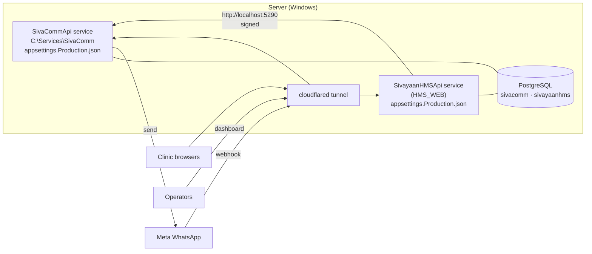
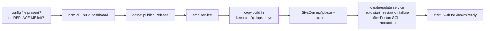

# Configuration and deployment, step by step

How to take SivaComm and HMS_WEB from a fresh server to live WhatsApp
password resets. **Every setting lives in a config file** — no dashboard
clicks are needed to deploy, and redeploying the same files gives the same
result. For what travels between the services, see
[WORKFLOWS.md](WORKFLOWS.md); for every key explained, [GUIDE.md](GUIDE.md) §8–9.

- [0. What you end up with](#0-what-you-end-up-with)
- [1. Before you start](#1-before-you-start)
- [2. Meta / WhatsApp](#2-meta--whatsapp)
- [3. SivaComm database](#3-sivacomm-database)
- [4. Generate the secrets](#4-generate-the-secrets)
- [5. SivaComm config file](#5-sivacomm-config-file)
- [6. Deploy SivaComm](#6-deploy-sivacomm)
- [7. Make SivaComm reachable (HTTPS)](#7-make-sivacomm-reachable-https)
- [8. Meta webhook](#8-meta-webhook)
- [9. HMS_WEB config file](#9-hms_web-config-file)
- [10. Deploy HMS_WEB](#10-deploy-hms_web)
- [11. Check it end to end](#11-check-it-end-to-end)
- [12. Day-2 changes — all by editing a file](#12-day-2-changes--all-by-editing-a-file)
- [13. Upgrading and rolling back](#13-upgrading-and-rolling-back)
- [14. Local development](#14-local-development)
- [Appendix: every value and where it goes](#appendix-every-value-and-where-it-goes)

---

## 0. What you end up with



| Piece | Where | Configured by |
|---|---|---|
| SivaComm API + worker + dashboard | Windows service `SivaCommApi`, folder `C:\Services\SivaComm` | `C:\Services\SivaComm\appsettings.Production.json` |
| SivaComm database | PostgreSQL database `sivacomm`, role `sivacomm` | — |
| HMS_WEB API | its existing Windows service | HMS_WEB's `appsettings.Production.json` (`SivaComm` section) |
| Public HTTPS names | Cloudflare Tunnel (as HMS already uses) | the tunnel's config |

The two config files are the whole deployment. Both are kept **out of
source control**; keep an encrypted copy somewhere safe.

---

## 1. Before you start

On the server:

| Need | Check |
|---|---|
| .NET 10 SDK (to build) — or build elsewhere and copy | `dotnet --list-sdks` shows `10.0.x` |
| Node.js 20+ (builds the dashboard) | `node --version` |
| PostgreSQL 16+ | the `postgresql-x64-*` service is running |
| An elevated PowerShell | the deploy script installs a service |
| The SivaComm repository | e.g. `C:\src\SivaComm` |
| A public hostname for SivaComm | e.g. `comm.sivayaan.com` (step 7) |

Start step 2 first — Meta's approvals take days; everything else takes an hour.

---

## 2. Meta / WhatsApp

Full walkthrough: [WHATSAPP_SETUP.md](WHATSAPP_SETUP.md). Collect these
**six values** — they all go into SivaComm's config file in step 5:

| # | Value | Where in Meta |
|---|---|---|
| M1 | Phone number **ID** (a long id, not the phone number) | WhatsApp → API Setup |
| M2 | **Permanent** access token | Business Settings → Users → System users → Generate token (permissions: `whatsapp_business_messaging`, `whatsapp_business_management`) |
| M3 | App secret | App settings → Basic → App secret |
| M4 | OTP template name, approved, category **Authentication**, *Copy code* button | WhatsApp Manager → Message templates |
| M5 | Welcome template name, approved, category **Utility** (HMS: `hms_welcome`, 2 placeholders) | same |
| M6 | Each template's **language code** exactly as approved (`en`, not `en_US` unless that is what you chose) | same |

HMS's welcome body, for submitting:

```
Welcome to Sivayaan HMS, {{1}}. Your admin username is {{2}} — sign in with the password you chose. Password reset codes will come to this number.
```

Until these exist you can still deploy everything: leave the `WhatsApp`
section empty and SivaComm runs normally but sends nothing (it logs that each
message was not sent).

---

## 3. SivaComm database

In an elevated PowerShell, as the PostgreSQL superuser. Choose a strong
password (it becomes **D1** in step 5):

```powershell
& "C:\Program Files\PostgreSQL\18\bin\psql.exe" -U postgres -c "CREATE ROLE sivacomm LOGIN PASSWORD 'D1-strong-password-here';"
& "C:\Program Files\PostgreSQL\18\bin\psql.exe" -U postgres -c "CREATE DATABASE sivacomm OWNER sivacomm ENCODING 'UTF8' TEMPLATE template0;"
```

The production role does **not** get `CREATEDB` (only a developer's test
role needs it). Tables are created by the deploy script's migration step.

Add `sivacomm` to whatever backs up `sivayaanhms` — the same nightly
`pg_dump`, the same off-machine copy.

---

## 4. Generate the secrets

Run each line in PowerShell (works in Windows PowerShell 5.1 and PowerShell 7)
and note the output:

```powershell
function New-Secret { $b = New-Object byte[] 32; [Security.Cryptography.RandomNumberGenerator]::Create().GetBytes($b); [Convert]::ToBase64String($b) }

New-Secret   # S1  Security:MasterKey
New-Secret   # S2  Admin:Password (first dashboard login) — or choose your own
New-Secret   # S3  WhatsApp:WebhookVerifyToken
New-Secret   # S4  hms-web signing secret (goes into BOTH config files)
```

| Secret | Used for | Lose it and… |
|---|---|---|
| **S1** master key | encrypts application secrets, phone numbers, queued messages; keys the OTP HMAC | stored secrets can't be read; restoring S1 fixes it. Back it up **off the server, separately from database backups** |
| **S2** admin password | first dashboard login only | nothing; it's only used while no admin exists |
| **S3** webhook verify token | Meta's one-time webhook handshake | re-run step 8 with a new one |
| **S4** application secret | HMS_WEB signs every call with it | put a new one in both files (step 12) |

Pick a key id to go with S4 — any short label, e.g. `hms-2026-10` (**K1**).

---

## 5. SivaComm config file

Create the install folder and the config file from the template:

```powershell
New-Item -ItemType Directory -Force C:\Services\SivaComm
Copy-Item C:\src\SivaComm\deploy\appsettings.Production.json.template C:\Services\SivaComm\appsettings.Production.json
notepad C:\Services\SivaComm\appsettings.Production.json
```

(Running the deploy script with no config file does the copy for you and
stops.)

Fill it in — every `REPLACE-ME` must go, or the deploy script refuses to run:

```jsonc
{
  "Urls": "http://localhost:5290",                       // where the service listens; the tunnel points here

  "Database": {
    "Host": "localhost", "Port": 5432,
    "Name": "sivacomm", "Username": "sivacomm",
    "Password": "D1",                                     // step 3
    "SslMode": "Prefer",                                  // Require if PostgreSQL is on another machine
    "MigrateOnStartup": false                             // the deploy script migrates
  },

  "Security": { "MasterKey": "S1" },                      // step 4

  "Admin": { "Username": "ops", "Password": "S2" },       // first dashboard login

  "WhatsApp": {                                           // step 2 — leave empty to run without sending
    "AccessToken": "M2",
    "PhoneNumberId": "M1",
    "AppSecret": "M3",
    "WebhookVerifyToken": "S3",
    "ApiVersion": "v21.0"
  },

  "Messaging": { "DefaultCountryCode": "91" },

  "Applications": [
    {
      "Code": "hms-web",
      "Name": "Sivayaan HMS",
      "Enabled": true,
      "Keys": [ { "KeyId": "K1", "Secret": "S4", "Revoked": false } ],
      "Templates": {
        "PasswordResetOtp": { "Name": "M4", "Language": "M6" },
        "Welcome":          { "Name": "M5", "Language": "M6", "Parameters": 2 }
      }
    }
  ],

  "DataProtection": { "KeysPath": "C:\\Services\\SivaComm\\keys" },

  "Logging": {
    "File": { "PathFormat": "C:\\Services\\SivaComm\\logs\\sivacomm-{Date}.log", "RetainedFileCountLimit": 31 }
  }

  // Otp, Worker and RateLimits are in the template with their defaults.
  // Leave them unless you mean to change policy (docs/SECURITY.md).
}
```

(`jsonc` above only to show comments; the real file uses `"//"` keys for
notes, as the template does.)

**What SivaComm checks when it starts — and refuses to start if wrong:**
database password present; master key present and not the development key;
OTP values in range; and every application entry valid (code format, unique
codes and key ids, secrets ≥ 32 characters, an enabled app has a live key,
template names present). The error lists every problem at once.

Lock the file down to administrators and the service account:

```powershell
icacls C:\Services\SivaComm\appsettings.Production.json /inheritance:r /grant:r "Administrators:F" "SYSTEM:R"
```

---

## 6. Deploy SivaComm

From the repository, in an elevated PowerShell:

```powershell
cd C:\src\SivaComm
.\deploy\Deploy-SivaComm.ps1
```



Options: `-InstallDir D:\SivaComm`, `-ServiceName SivaCommApi`,
`-SkipDashboard` (reuse the last dashboard build).

Expected ending:

```
==> Ready: http://localhost:5290/health/ready
==> Dashboard: http://localhost:5290/
```

Then check the log (`C:\Services\SivaComm\logs\sivacomm-YYYYMMDD.log`) for:

```
[INF] Application from configuration — "hms-web: enabled, 1 live key(s), OTP template sivayaan_otp, welcome template hms_welcome"
[WRN] Created the first dashboard admin 'ops' from configuration.
```

If the `WhatsApp` section is empty you will also see *"No WhatsApp provider
is configured. Messages are NOT sent…"* — expected until step 2 is done.

---

## 7. Make SivaComm reachable (HTTPS)

Meta must reach the webhook, and the dashboard's login cookie only works
over HTTPS outside development. With the Cloudflare Tunnel HMS already uses,
add a public hostname for SivaComm pointing at the `Urls` value:

```yaml
# cloudflared config.yml — add above the catch-all rule
ingress:
  - hostname: comm.sivayaan.com
    service: http://localhost:5290
  # … existing HMS rules …
  - service: http_status:404
```

Then route the name (`cloudflared tunnel route dns <tunnel> comm.sivayaan.com`)
and restart cloudflared. Check from outside: `https://comm.sivayaan.com/health/ready`
→ `ready`, and the dashboard login page loads at `https://comm.sivayaan.com/`.

HMS_WEB on the same machine does **not** need the public name: it calls
`http://localhost:5290` directly (step 9). Applications on other machines use
`https://comm.sivayaan.com`.

---

## 8. Meta webhook

Meta for Developers → your app → WhatsApp → Configuration → Webhook:

| Field | Value |
|---|---|
| Callback URL | `https://comm.sivayaan.com/api/v1/webhooks/whatsapp` |
| Verify token | **S3** (same as `WhatsApp:WebhookVerifyToken`) |
| Subscribe | `messages` |

*Verify and save* must succeed. If it fails: the hostname isn't reachable
(step 7), or S3 differs between Meta and the config file.

---

## 9. HMS_WEB config file

In HMS_WEB's `appsettings.Production.json` (beside its exe), add or edit:

```json
"SivaComm": {
  "Enabled": true,
  "BaseUrl": "http://localhost:5290",
  "ClientId": "hms-web",
  "KeyId": "K1",
  "Secret": "S4",
  "TimeoutSeconds": 10
},

"PasswordReset": {
  "Enabled": true
}
```

| Key | Must equal |
|---|---|
| `SivaComm:BaseUrl` | SivaComm's `Urls` if on the same machine, otherwise its public `https://` name |
| `SivaComm:ClientId` | SivaComm `Applications[].Code` |
| `SivaComm:KeyId` | SivaComm `Applications[].Keys[].KeyId` |
| `SivaComm:Secret` | SivaComm `Applications[].Keys[].Secret` |

`SivaComm:Enabled: false` (or the section left out) keeps HMS_WEB on its
normal flow — sending its own codes through its own `WhatsApp` section — and
nothing in HMS talks to SivaComm. `PasswordReset:Enabled: false` removes
self-service reset altogether.

With `Enabled: true` and any of the other four missing, HMS_WEB refuses to
start and names the section — a mistake shows at deploy, not at the first
forgotten password.

---

## 10. Deploy HMS_WEB

HMS_WEB's own runbook, unchanged (HMS_WEB `README.md`, "Running in
production"):

```powershell
cd C:\src\HMS_WEB
.\deploy\Migrate-Database.ps1 -DryRun     # shows the pending migration: PasswordResetTransactions
Stop-Service SivayaanHMSApi
.\deploy\Migrate-Database.ps1             # backs up, then migrates
.\deploy\Deploy-Production.ps1            # publish and restart
```

Then push the frontend branch Cloudflare Pages builds, as for any release —
the new three-step reset page and the conditional *Forgot password?* link are
in it.

Order across the two services: **SivaComm first** (steps 3–8), then HMS_WEB.
HMS_WEB with `SivaComm:Enabled: true` needs SivaComm answering; with `false`
the order doesn't matter.

---

## 11. Check it end to end

| # | Do | Expect |
|---|---|---|
| 1 | `https://comm.sivayaan.com/health/ready` | `ready` |
| 2 | Sign in to the dashboard as `ops` / S2 | Overview loads; Applications lists *Sivayaan HMS* with key K1 and both templates |
| 3 | In HMS, register a test clinic with **your** mobile | WhatsApp welcome arrives; dashboard *Messages* shows a **Welcome** row going *Submitted → Delivered* |
| 4 | HMS sign-in → *Forgot password?* → your test username | code arrives on WhatsApp; dashboard shows an **OTP** row |
| 5 | Enter a wrong code | "That code is not right… 4 tries left" |
| 6 | Enter the right code | new-password fields appear |
| 7 | Set a password, sign in with it | works; the old password doesn't |
| 8 | Dashboard → Overview | OTPs created 1, verified 1, failed checks 1, resets completed 1, welcome 1 |

A **Failed** row shows Meta's reason in *Error* — see [GUIDE.md §12](GUIDE.md#12--operating-it)
for the common ones.

---

## 12. Day-2 changes — all by editing a file

Every change below is: edit the file → restart the service (`Restart-Service SivaCommApi`, or HMS's service). Nothing else.

**Rotate HMS's signing key (no downtime)**

1. SivaComm file — add a second key, keep the old:
   ```json
   "Keys": [
     { "KeyId": "hms-2026-10", "Secret": "S4",     "Revoked": false },
     { "KeyId": "hms-2027-04", "Secret": "S4-new", "Revoked": false }
   ]
   ```
   Restart SivaComm.
2. HMS file — `KeyId: "hms-2027-04"`, `Secret: "S4-new"`. Restart HMS.
3. SivaComm file — set the old key `"Revoked": true`. Restart SivaComm.

**Key leaked** — set it `"Revoked": true` in SivaComm's file and restart:
HMS's resets fail safe (`TEMPORARY_ERROR`) until both files have a new key.

**Change a template** (Meta approved a new one) — edit
`Applications[].Templates.*.Name` / `Language` / `Parameters`; restart
SivaComm. Queued messages already waiting keep the template they were
queued with.

**Add an application** (Swarnakshi, TransTrack) — add an entry to
`Applications` with its own `Code`, a new key (step 4) and its templates;
restart SivaComm; give that application the same `ClientId` / `KeyId` /
`Secret`.

**Pause an application** — `"Enabled": false`; restart. Every call it makes
is refused until you set it back.

**Turn SivaComm off for HMS** — HMS file `SivaComm:Enabled: false`; restart
HMS. It goes back to its normal flow; resets that were mid-way are closed and
the person starts again.

**New Meta token** — `WhatsApp:AccessToken`; restart SivaComm.

**Never change** `Security:MasterKey` on a running system — it would make
stored secrets unreadable. If it must change, it's a planned migration, not
a config edit.

**Dashboard** — the Applications page can also issue/revoke keys and change
templates. For an application listed in the config file, the **file wins at
the next restart**; use the dashboard for those only in an emergency, then
write the same change into the file.

---

## 13. Upgrading and rolling back

**Upgrade:** pull the new code, run `.\deploy\Deploy-SivaComm.ps1` again. It
keeps `appsettings.Production.json`, `logs\` and `keys\`, migrates, and
restarts. Take a database backup first if the release notes mention a
migration:

```powershell
& "C:\Program Files\PostgreSQL\18\bin\pg_dump.exe" -U sivacomm -Fc -f "D:\backups\sivacomm-$(Get-Date -Format yyyyMMdd-HHmm).dump" sivacomm
```

**Roll back:** check out the previous version and run the deploy script
again. If that version's database is older than the current one, restore the
backup taken before the upgrade (`pg_restore -c -d sivacomm …`) first.

**Roll back HMS's use of SivaComm only:** `SivaComm:Enabled: false` in HMS's
file and restart HMS — immediate, no deploy.

---

## 14. Local development

Same files, development names:

| | |
|---|---|
| Role | `CREATE ROLE sivacomm LOGIN CREATEDB PASSWORD '…';` (CREATEDB for the tests) |
| Config | `backend/src/SivaComm.Api/appsettings.Local.json` (git-ignored) — `Database:Password`, `Admin`, optionally an `Applications` entry |
| Master key | the public development key in `appsettings.Development.json` — refused outside Development |
| Database | `sivacomm_dev`, created and migrated on start |
| Run | `cd backend; dotnet run --project src/SivaComm.Api` → http://localhost:5290 |
| Dashboard dev server | `cd dashboard; npm install; npm run dev` → http://localhost:5291 |
| Tests | `$env:SIVACOMM_TEST_PG = "Host=localhost;Username=sivacomm;Password=…"; dotnet test backend` |

Without a `WhatsApp` section in Development, each OTP is printed in the
console/log — that's how a code is read on a laptop.

---

## Appendix: every value and where it goes

| Value | SivaComm `appsettings.Production.json` | HMS_WEB `appsettings.Production.json` | Meta |
|---|---|---|---|
| D1 database password | `Database:Password` | — | — |
| S1 master key | `Security:MasterKey` | — | — |
| S2 first admin password | `Admin:Password` | — | — |
| M1 phone number id | `WhatsApp:PhoneNumberId` | — | API Setup |
| M2 permanent token | `WhatsApp:AccessToken` | — | System user |
| M3 app secret | `WhatsApp:AppSecret` | — | App settings |
| S3 webhook verify token | `WhatsApp:WebhookVerifyToken` | — | Webhook setup |
| M4 / M6 OTP template + language | `Applications[].Templates.PasswordResetOtp` | — | Templates |
| M5 / M6 welcome template + language | `Applications[].Templates.Welcome` (+ `Parameters`) | — | Templates |
| application code | `Applications[].Code` | `SivaComm:ClientId` | — |
| K1 key id | `Applications[].Keys[].KeyId` | `SivaComm:KeyId` | — |
| S4 signing secret | `Applications[].Keys[].Secret` | `SivaComm:Secret` | — |
| SivaComm address | `Urls` | `SivaComm:BaseUrl` | webhook URL (public name) |
| switch | — | `SivaComm:Enabled` | — |
| reset on/off | — | `PasswordReset:Enabled` | — |
