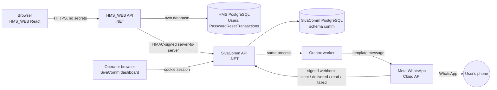
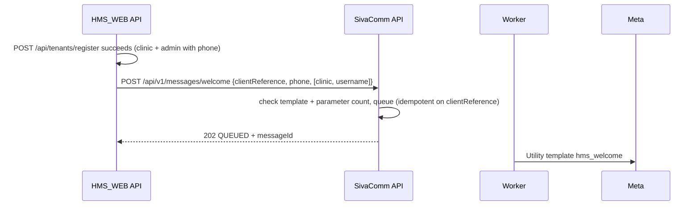
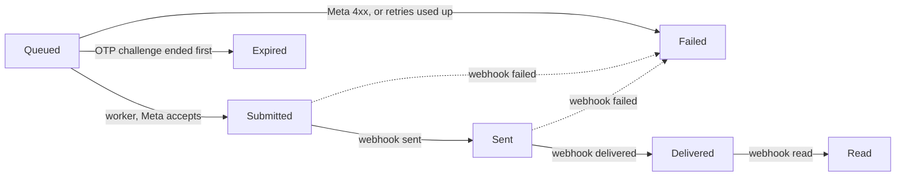

# Sivayaan Communications (SivaComm) — complete guide

Flow, configuration and operation of the central WhatsApp messaging service
and its first integration, HMS_WEB. One document to read end to end; the
shorter pages in this folder ([API.md](API.md), [SECURITY.md](SECURITY.md),
[CONFIGURATION.md](CONFIGURATION.md), [DEPLOYMENT.md](DEPLOYMENT.md),
[WHATSAPP_SETUP.md](WHATSAPP_SETUP.md)) go deeper on single topics.

**Contents**

1. [What it is and who owns what](#1--what-it-is-and-who-owns-what)
2. [Architecture](#2--architecture)
3. [Password reset — the full flow](#3--password-reset--the-full-flow)
4. [Welcome message flow](#4--welcome-message-flow)
5. [Delivery tracking flow](#5--delivery-tracking-flow)
6. [States and statuses](#6--states-and-statuses)
7. [What happens when something fails](#7--what-happens-when-something-fails)
8. [Configuration reference — HMS_WEB](#8--configuration-reference--hms_web)
9. [Configuration reference — SivaComm](#9--configuration-reference--sivacomm)
10. [Setting it up, start to finish](#10--setting-it-up-start-to-finish)
11. [Security model](#11--security-model)
12. [Operating it](#12--operating-it)
13. [Testing](#13--testing)
14. [Known gaps and next steps](#14--known-gaps-and-next-steps)

---

## 1 · What it is and who owns what

SivaComm is one service that every Sivayaan application (HMS_WEB first;
Swarnakshi and TransTrack Web next) uses to send WhatsApp messages:

- **password-reset codes (OTP)** — generated, sent and verified by SivaComm;
- **welcome messages** — sent when an account is created;
- **delivery tracking and reporting** — an admin dashboard showing every
  message, its delivery status and per-application counts.

The rule the design is built around:

> **The application that owns the user owns the password reset.**
> SivaComm proves the person holds the phone. The application decides
> everything else and changes the password in its own database.
> SivaComm never receives, stores or changes a password.

| Responsibility | Source application (HMS_WEB) | SivaComm |
|---|---|---|
| Who the user is, which account | ✅ | — |
| Which phone the code goes to (the one **on file**) | ✅ | — |
| Enumeration protection (same answer for unknown users) | ✅ | — |
| The reset transaction and its state | ✅ | — |
| Generating, storing (as HMAC), sending the code | — | ✅ |
| Checking the code, attempts, expiry | — | ✅ |
| Issuing the one-time verification grant | — | ✅ |
| Deciding the new-password step may be shown | ✅ (from SivaComm's answer, recorded server-side) | — |
| Password policy and changing the password | ✅ | — (never sees it) |
| Delivery receipts, dashboard, audit of messages | — | ✅ |

---

## 2 · Architecture



| Part | Technology | Notes |
|---|---|---|
| SivaComm API | ASP.NET Core (.NET 10) | `backend/src/SivaComm.Api` — endpoints, auth, serves the dashboard |
| SivaComm data + services | EF Core 10 + Npgsql | `backend/src/SivaComm.Data` — OTP, grants, outbox, webhook, providers |
| Outbox worker | Hosted service in the API process | claims queued rows with `FOR UPDATE SKIP LOCKED`; no Redis/queue broker |
| Database | PostgreSQL 16+ | its own database, schema `comm`; never shares an application's database |
| Dashboard | React + TypeScript (Vite) | `dashboard/`; built into the API's `wwwroot`, same origin |
| HMS_WEB integration | 4 files in `SivayaanHMS.Data/Messaging` + `PasswordResetFlow.cs` | no shared package; the signature is specified in API.md |

**Why an outbox:** the API writes the message row in the same transaction as
the OTP challenge and returns immediately. Sending happens a moment later in
the worker. So verification is never slowed by Meta, and a Meta outage never
loses a message — it is retried.

---

## 3 · Password reset — the full flow

### 3.1 What the user sees (HMS_WEB, `SivaComm:Enabled = true`)

Three steps on one page (`/forgot-password`). With the flag off — the
default — HMS_WEB shows its original page instead; see §3.3.

1. **Reset your password** — enter username (`you@your-clinic`) → *Send code*.
   Always the same message: *"If that account exists and has a phone number on
   file, a code is on its way."*
2. **Enter your code** — the 6-digit code from WhatsApp → *Verify code*.
   Wrong code: *"That code is not right… 4 tries left."* Expired / too many
   tries: *Start again*. *Send it again* is offered after 60 seconds.
3. **Choose a new password** — shown **only** after the server said
   `VERIFIED` → *Set new password* → back to sign-in.

### 3.2 End to end, with SivaComm enabled

```mermaid
sequenceDiagram
    autonumber
    actor U as User (browser)
    participant H as HMS_WEB API
    participant HD as HMS DB
    participant S as SivaComm API
    participant SD as SivaComm DB
    participant W as Outbox worker
    participant M as Meta WhatsApp

    U->>H: POST /api/auth/forgot-password {username}
    H->>HD: resolve clinic + user, phone on file
    H->>HD: close user's open resets; insert PasswordResetTransaction (CodeSent)
    H->>S: POST /api/v1/otp/challenges {resetReference, userReference, phone} (signed)
    S->>SD: one tx: supersede old challenges, insert challenge (OTP as HMAC), insert outbox message (OTP encrypted)
    S-->>H: 202 QUEUED + challengeId
    H->>HD: store challengeId on the transaction
    H-->>U: 200 {generic message, resetToken}
    W->>SD: claim queued message
    W->>M: send Authentication template with the code
    M-->>W: accepted (wamid)
    W->>SD: Submitted, wipe encrypted payload
    M-->>U: WhatsApp message with code

    U->>H: POST /api/auth/verify-reset-code {resetToken, code}
    H->>S: POST /otp/challenges/{id}/verify {resetReference, otp} (signed)
    S->>SD: lock challenge row; check binding, status, expiry, attempts, HMAC
    S-->>H: 200 VERIFIED + verificationGrant
    H->>HD: transaction → Verified; store grant ENCRYPTED
    H-->>U: 200 VERIFIED (no grant to the browser)

    U->>H: POST /api/auth/reset-password {resetToken, newPassword}
    H->>HD: transaction must be Verified and not expired
    H->>S: POST /grants/consume {grant, resetReference} + Idempotency-Key (signed)
    S->>SD: lock grant row; single use
    S-->>H: 200 CONSUMED {resetReference, userReference}
    H->>H: check both references match
    H->>HD: ONE SaveChanges: new password hash, MustChangePassword=false, transaction → PasswordChanged
    H-->>U: 200 PASSWORD_CHANGED
    H->>S: POST /otp/challenges/{id}/completion (reporting only)
```

### 3.3 With SivaComm disabled (the normal flow)

**The flag is off by default, and off is HMS_WEB exactly as it was before
SivaComm** — the original page, endpoints and code, untouched:

| Step | `SivaComm:Enabled = false` (default) |
|---|---|
| Ask for a code | `POST /api/auth/forgot-password {username}` → `{ message }`. HMS_WEB stores the code (hashed) in its own `PasswordResetCodes` table and sends it through its own WhatsApp sender, or writes it to the log if WhatsApp is not configured |
| Code + new password, one screen | `POST /api/auth/reset-password {username, code, newPassword}` — checked and saved in one call (5 attempts, 10 minutes) |
| Welcome | sent by HMS_WEB itself |
| SivaComm | never called; `verify-reset-code` / `resend-reset-code` answer 404; no `PasswordResetTransactions` rows |

The three-step screen in §3.1–3.2 appears only when the flag is on.

### 3.4 Identifiers that travel

| Name | Example | Created by | Seen by browser? |
|---|---|---|---|
| `resetToken` | 43 random chars | HMS_WEB | ✅ (only this) |
| reset transaction id → `resetReference` | `hms-6f1c…` | HMS_WEB | no |
| `userReference` | `u-1b2c…` (HMS internal user id) | HMS_WEB | no |
| `challengeId` | UUID | SivaComm | no |
| OTP | `482913` | SivaComm | only on the phone |
| `verificationGrant` | 43 random chars | SivaComm | **never** |

The browser holds one opaque token. It cannot name a user, a phone, a
challenge or a grant, so it cannot create or complete a reset on its own say.

### 3.5 Enumeration protection

An attacker typing usernames must not learn which exist:

- `forgot-password` returns the same text and a `resetToken` for **every**
  username — real, unknown, inactive, or without a phone.
- For anything but a real, reachable account, the token is backed by a
  **decoy** transaction that fails *Verify* exactly like a wrong code:
  4, 3, 2, 1 tries left, then locked.
- *Resend* always answers the same sentence; the cooldown is enforced
  silently by the server and shown by the page's own 60-second timer.
- With self-service reset turned off, `forgot-password` refuses **before**
  looking at the username.

---

## 4 · Welcome message flow



- No password is ever in the welcome. It carries the clinic name and the
  full username (`drsri@sunrise`) — the part people actually forget.
- `clientReference` is derived from the content, so a retried registration
  does not send two welcomes.
- A failed welcome never fails the registration.
- With SivaComm disabled, HMS_WEB sends it itself (same template, same words).

---

## 5 · Delivery tracking flow



- Meta calls `POST /api/v1/webhooks/whatsapp`; SivaComm checks
  `X-Hub-Signature-256` against the app secret **before** reading the body.
- Duplicates are ignored (each `messageId:status` is stored once).
- Out-of-order events never move a status backwards ("delivered" then "sent"
  stays Delivered; "failed" after "delivered" is ignored).
- An event that arrives before the worker has recorded Meta's id is stored
  and applied when the id is recorded.

**Delivery is not verification.** A *Delivered* code may never be typed in,
and a *Failed* delivery does not stop a code that did arrive from working.
The dashboard shows the two side by side: *Delivery* and *OTP state*.

---

## 6 · States and statuses

### 6.1 HMS_WEB reset transaction (`PasswordResetTransactions.Stage`)

| Stage | Meaning | Next |
|---|---|---|
| `CodeSent` | code requested (or decoy) | `Verified`, `Closed` |
| `Verified` | backend verified the code; new password may be accepted | `PasswordChanged`, `Closed` |
| `PasswordChanged` | done | — |
| `Closed` | ended: expired (30 min), attempts used, cancelled, superseded by a new reset | — |

### 6.2 SivaComm OTP challenge

| Status | Meaning |
|---|---|
| `Pending` | code sent, waiting |
| `Verified` | correct code; grant issued |
| `Expired` | past 10 minutes |
| `AttemptsExceeded` | 5 wrong tries |
| `Cancelled` | cancelled by the application |
| `Superseded` | a newer challenge for the same user replaced it |

Plus, separately: grant `consumed` (time + idempotency key) and challenge
`completed` (application reported the password change).

### 6.3 What HMS_WEB tells the browser

| `status` | HTTP | Page does |
|---|---|---|
| `VERIFIED` | 200 | shows new-password fields |
| `PASSWORD_CHANGED` | 200 | goes to sign-in |
| `INVALID_OTP` | 400 | "not right, N tries left", stays |
| `EXPIRED`, `ATTEMPTS_EXCEEDED`, `ALREADY_USED`, `CANCELLED` | 400 | reset over → *Start again* |
| `NOT_VERIFIED` | 400 | password step attempted without a verified code |
| `INVALID_PASSWORD` | 400 | fewer than 8 characters |
| `RATE_LIMITED` | 429 | wait |
| `DISABLED` | 403 | self-service reset is switched off |
| `TEMPORARY_ERROR` | 503 | "try again in a moment" — **never** success |

### 6.4 What SivaComm tells the application

| `status` | HTTP | |
|---|---|---|
| `QUEUED` | 202 | accepted for sending — not delivered |
| `VERIFIED` | 200 | with `verificationGrant` |
| `CONSUMED` | 200 | `replayed: true` when the same Idempotency-Key retried |
| `COMPLETED` | 200 | completion recorded |
| `CANCELLED` | 200 from `/cancel`, 409 elsewhere | |
| `INVALID_OTP` | 422 | with `remainingAttempts` |
| `EXPIRED`, `ATTEMPTS_EXCEEDED` | 422 | |
| `ALREADY_USED`, `CONFLICT` | 409 | |
| `RATE_LIMITED` | 429 | `Retry-After` |
| `CHALLENGE_NOT_FOUND`, `GRANT_NOT_FOUND` | 404 | includes "another application's" and "wrong reference" |
| `INVALID_REQUEST` | 400 | bad body, unknown field, no template set |
| `UNAUTHORIZED` | 401 | bad or missing signature |
| `TEMPORARY_ERROR` | 503 | database / infrastructure |

Every response carries `correlationId`, also returned as `X-Correlation-Id`.

---

## 7 · What happens when something fails

| Situation | Result | Recovery |
|---|---|---|
| SivaComm down, slow (>10 s), 5xx, 401, unreadable answer | HMS: `TEMPORARY_ERROR` (503) | user retries the same code; nothing is assumed verified |
| Meta down or throttling | message stays Queued, retried up to 5 times with growing, jittered delays | automatic; then `Failed` in the dashboard |
| Meta refuses (bad template, expired token, unknown number) | `Failed` at once, Meta's code recorded | fix config; user requests a new code |
| Code typed after 10 minutes | `EXPIRED` | *Start again* |
| 5 wrong codes (even if sent at the same moment) | `ATTEMPTS_EXCEEDED` | *Start again* |
| Same correct code submitted twice at once | exactly one `VERIFIED`, the other `ALREADY_USED` | — |
| Verify response lost on the way back to HMS | challenge already spent | user starts again |
| Grant consumed, then HMS database write fails | HMS transaction stays `Verified` | resubmit: same Idempotency-Key → `CONSUMED` again → password change retried |
| Password changed, response to browser lost | resubmit within 5 min → `PASSWORD_CHANGED`, nothing changed twice | later: `ALREADY_USED` |
| Two password submits at once | row version lets one through; the other sees it done | — |
| User asks for a new code | older code and older reset both stop working | — |
| Flag switched while a reset is open | that reset is closed (each records which service issued it) | user starts again |

---

## 8 · Configuration reference — HMS_WEB

File: `backend/src/SivayaanHMS.Api/appsettings.Production.json` on the
server (git-ignored; template: `appsettings.Production.json.template`), or
`appsettings.Local.json` on a developer machine. Every key also works as an
environment variable with `__` (e.g. `SivaComm__Secret`).

### 8.1 `SivaComm` — the switch

| Key | Default | Meaning |
|---|---|---|
| `SivaComm:Enabled` | `false` | **`true`: OTP authentication and welcome messages through SivaComm. `false`: the normal flow inside HMS_WEB.** |
| `SivaComm:BaseUrl` | — | SivaComm origin, e.g. `https://comm.sivayaan.example`. Server to server; never given to the browser. Required when enabled. |
| `SivaComm:ClientId` | `hms-web` | the application code registered in SivaComm. Required when enabled. |
| `SivaComm:KeyId` | — | key id shown by the SivaComm dashboard. Required when enabled. |
| `SivaComm:Secret` | — | signing secret shown **once** by the dashboard. Production file or `SivaComm__Secret` only — never committed. Required when enabled. |
| `SivaComm:TimeoutSeconds` | `10` | per-call limit; past it the call is a `TEMPORARY_ERROR` |

Enabled with any required value missing → HMS_WEB **refuses to start** and
names the section.

### 8.2 `PasswordReset` — optional kill switch

| Key | Default | Meaning |
|---|---|---|
| `PasswordReset:Enabled` | `true` | `false`: no *Forgot password* link ("ask your clinic admin"), every reset endpoint answers 403 `DISABLED`. Independent of `SivaComm:Enabled`. |

### 8.3 `WhatsApp` — used only when SivaComm is disabled

| Key | Default | Meaning |
|---|---|---|
| `WhatsApp:AccessToken` | — | permanent system-user token. Empty → messages go to the log. |
| `WhatsApp:PhoneNumberId` | — | phone number **ID** from Meta |
| `WhatsApp:WelcomeTemplate` | `hms_welcome` | |
| `WhatsApp:ResetCodeTemplate` | `hms_password_reset` | |
| `WhatsApp:LanguageCode` | `en` | must match the approved template exactly |
| `WhatsApp:DefaultCountryCode` | `91` | prepended to a bare national number |

### 8.4 Examples

Normal flow (nothing to add — this is the default):

```json
{ "SivaComm": { "Enabled": false } }
```

OTP through SivaComm:

```json
{
  "SivaComm": {
    "Enabled": true,
    "BaseUrl": "https://comm.sivayaan.example",
    "ClientId": "hms-web",
    "KeyId": "k20261024ab12cd",
    "Secret": "<shown once in the SivaComm dashboard>",
    "TimeoutSeconds": 10
  }
}
```

No self-service reset at all:

```json
{ "PasswordReset": { "Enabled": false } }
```

### 8.5 HMS endpoints involved

| Endpoint | Body | Notes |
|---|---|---|
| `GET /api/auth/options` | — | `{ passwordResetEnabled }` for the sign-in page |
| `POST /api/auth/forgot-password` | `{ username }` | → `{ message, resetToken }` |
| `POST /api/auth/resend-reset-code` | `{ resetToken }` | always the same message |
| `POST /api/auth/verify-reset-code` | `{ resetToken, code }` | → step response |
| `POST /api/auth/reset-password` | `{ resetToken, newPassword }` | → step response; the old `{ username, code, newPassword }` shape still works when SivaComm is disabled |

Database change: one new table, `PasswordResetTransactions` (migration
`20261024160740_PasswordResetTransactions`, additive only). Run migrations
before starting the new build, as for every release.

---

## 9 · Configuration reference — SivaComm

File: `backend/src/SivaComm.Api/appsettings.Production.json` (git-ignored),
`appsettings.Local.json` for development, or environment variables.

### 9.1 Required

| Key | Meaning |
|---|---|
| `Database:Password` | password of the `sivacomm` role (or `Database:ConnectionString` for a full string) |
| `Security:MasterKey` | 32+ random bytes, base64. Encrypts application secrets, phone numbers and queued payloads; keys the OTP HMAC. Refused if missing or the development key, outside Development. **Back it up separately from the database.** |
| `Admin:Username`, `Admin:Password` | first dashboard login; only used while no admin exists |

Generate a master key:

```powershell
$b = New-Object byte[] 32; [Security.Cryptography.RandomNumberGenerator]::Create().GetBytes($b); [Convert]::ToBase64String($b)
```

### 9.2 Meta / WhatsApp

| Key | Meaning |
|---|---|
| `WhatsApp:AccessToken` | permanent system-user token. Empty → messages are logged, not sent. |
| `WhatsApp:PhoneNumberId` | the phone number **ID** |
| `WhatsApp:AppSecret` | checks webhook signatures; without it every webhook is refused |
| `WhatsApp:WebhookVerifyToken` | the string you type into Meta's webhook setup |
| `WhatsApp:ApiVersion` | default `v21.0` |
| `Messaging:DefaultCountryCode` | default `91`; empty = refuse numbers without a country code |

### 9.3 Database

| Key | Default |
|---|---|
| `Database:Host` / `Port` / `Name` / `Username` | `localhost` / `5432` / `sivacomm` / `sivacomm` |
| `Database:SslMode` | `Prefer` (use `Require` across a network) |
| `Database:MaxPoolSize` | `30` |
| `Database:CommandTimeoutSeconds` | `15` |
| `Database:MigrateOnStartup` | null = yes in Development only |

### 9.4 OTP rules (defaults are deliberate — see SECURITY.md)

| Key | Default |
|---|---|
| `Otp:Length` | `6` (6–9) |
| `Otp:ExpiryMinutes` | `10` |
| `Otp:MaxAttempts` | `5` |
| `Otp:MaxSendsPerWindow` / `Otp:SendWindowMinutes` | `3` / `15` |
| `Otp:ResendCooldownSeconds` | `60` |
| `Otp:GrantExpiryMinutes` | `10` |
| `Security:ClockSkewSeconds` | `300` (request timestamp tolerance) |

### 9.5 Worker, retention, limits

| Key | Default |
|---|---|
| `Worker:Enabled` | `true` |
| `Worker:BatchSize` / `MaxConcurrency` | `10` / `4` |
| `Worker:MaxAttempts` | `5` |
| `Worker:BaseBackoffSeconds` / `MaxBackoffSeconds` | `5` / `300` |
| `Worker:ProviderTimeoutSeconds` | `10` |
| `Worker:RecipientRetentionDays` | `30` (encrypted phone numbers wiped) |
| `Worker:RecordRetentionDays` | `180` (challenges, messages, events, audit deleted) |
| `RateLimits:CreatePerMinute` / `VerifyPerMinute` | `60` / `300` per application |

### 9.6 `Applications` — consuming applications, keys and templates

In the config file, applied at every start (the database follows the file
for every application it lists; a mistake stops the service at start with a
list of what is wrong):

| Key | Meaning |
|---|---|
| `Applications[].Code` | e.g. `hms-web` — must equal that application's `SivaComm:ClientId` |
| `Applications[].Name` | shown in the dashboard |
| `Applications[].Enabled` | `false` → every call it makes is refused |
| `Applications[].Keys[].KeyId` | short label, e.g. `hms-2026-10` — equals the application's `SivaComm:KeyId` |
| `Applications[].Keys[].Secret` | 32+ random characters — equals the application's `SivaComm:Secret` |
| `Applications[].Keys[].Revoked` | `true` stops that key (rotation, leak) |
| `Applications[].Templates.PasswordResetOtp` | `Name`, `Language` of the approved **Authentication** template (always 1 parameter) |
| `Applications[].Templates.Welcome` | `Name`, `Language`, `Parameters` of the approved **Utility** template |

The dashboard's Applications page can make the same changes; for an
application in the file, the file wins at the next restart.

### 9.7 Hosting

| Key | Default | Meaning |
|---|---|---|
| `Urls` | `http://localhost:6071` | where the service listens |
| `Cors:AllowedOrigins` | `[]` | the dashboard's origin when it is not served by the API — production: `["https://sivacom.sivayaantechnologies.com"]` |
| `DataProtection:KeysPath` | — | folder for the dashboard's login-cookie keys; set it, or every restart signs operators out |
| `Logging:File:PathFormat` | — | daily log file, e.g. `C:\Server\sivacomapi\logs\sivacomm-{Date}.log`; a service has no console |
| `Logging:File:RetainedFileCountLimit` | `31` | days of log files kept |

### 9.8 Full example

The complete, commented file is `deploy/appsettings.Production.json.template`.
In short:

```json
{
  "Urls": "http://localhost:6071",
  "Database": { "Host": "localhost", "Name": "sivacomm", "Username": "sivacomm", "Password": "…" },
  "Security": { "MasterKey": "…" },
  "Admin":    { "Username": "ops", "Password": "…" },
  "WhatsApp": {
    "AccessToken": "EAAG…",
    "PhoneNumberId": "123456789012345",
    "AppSecret": "…",
    "WebhookVerifyToken": "…"
  },
  "Messaging": { "DefaultCountryCode": "91" },
  "Applications": [
    {
      "Code": "hms-web", "Name": "Sivayaan HMS", "Enabled": true,
      "Keys": [ { "KeyId": "hms-2026-10", "Secret": "…" } ],
      "Templates": {
        "PasswordResetOtp": { "Name": "sivayaan_otp", "Language": "en" },
        "Welcome":          { "Name": "hms_welcome", "Language": "en", "Parameters": 2 }
      }
    }
  ],
  "DataProtection": { "KeysPath": "C:\\Server\\sivacomapi\\keys" },
  "Logging": { "File": { "PathFormat": "C:\\Server\\sivacomapi\\logs\\sivacomm-{Date}.log" } }
}
```

---

## 10 · Setting it up, start to finish

| # | Step | Where | Done when |
|---|---|---|---|
| 1 | Meta Business account, app with WhatsApp, business verification, real number | business.facebook.com | number shows in WhatsApp Manager |
| 2 | Permanent system-user token; note phone number ID and app secret | Business Settings | you have 3 values |
| 3 | Submit templates: **Authentication** (code) and **Utility** `hms_welcome` | WhatsApp Manager | both *Approved* |
| 4 | Create role and database `sivacomm` | PostgreSQL | `psql -U sivacomm` connects |
| 5 | Generate master key, admin password, webhook token, HMS signing secret | PowerShell | 4 values |
| 6 | Write SivaComm `appsettings.Production.json` from the template — including the `Applications` entry for `hms-web` with its key and templates (§9.8) | server | no `REPLACE-ME` left |
| 7 | `.\deploy\Deploy-SivaComm.ps1` — builds, migrates, installs the Windows service, starts it | server | `/health/ready` → `ready` |
| 8 | Public HTTPS name through the tunnel; Meta webhook → `https://<host>/api/v1/webhooks/whatsapp` | cloudflared, Meta | Meta shows *Verified* |
| 9 | HMS_WEB: `SivaComm` section with `Enabled: true` and the same `KeyId`/`Secret` (§8.4); its usual migrate + deploy | HMS server | HMS starts without error |
| 10 | Test: register a clinic with your number; *Forgot password* | HMS + phone | welcome and code arrive; dashboard shows *Delivered* |

Every one of these is a config-file value or a script; nothing has to be
clicked in the dashboard. The detailed version, with commands, is
[DEPLOYMENT.md](DEPLOYMENT.md); the request/response diagrams are
[WORKFLOWS.md](WORKFLOWS.md).

Until steps 1–3 are done, steps 4–10 can run with `WhatsApp` empty:
everything works, and SivaComm logs each message as not sent.

Local development: [DEPLOYMENT.md](DEPLOYMENT.md) §14.

---

## 11 · Security model

| Threat | Control |
|---|---|
| Code sent to an attacker's phone | only the number already on the account is used; the browser cannot supply one |
| Guessing the code | 6 digits, 5 attempts, 10 minutes; concurrent guesses cannot exceed the limit (row lock) |
| Flooding a phone with codes | 3 sends per user per 15 minutes; 60 s resend cooldown; per-application rate limit |
| Database dump reveals codes | codes stored only as HMAC with a key outside the database; queued codes encrypted and wiped after sending |
| Skipping the code step | HMS accepts a new password only when its own record says `Verified`; SivaComm grant consumed first |
| Replaying a grant | single use; bound to application + reset reference; 10 min; other idempotency key → `ALREADY_USED` |
| One application acting for another | identity comes only from the request signature; every lookup filtered by it; foreign ids → not found |
| Forged or replayed API calls | HMAC-SHA256 over method, path, timestamp, nonce, body hash; ±5 min; nonce single use |
| Password leaking to SivaComm | no password field exists; unknown JSON fields are rejected |
| Learning which usernames exist | identical responses, decoy resets, silent cooldowns |
| Outage mistaken for success | every failure path is `TEMPORARY_ERROR`; covered by tests |
| Forged delivery webhooks | `X-Hub-Signature-256` verified before parsing |
| Dashboard abuse | separate cookie auth, SameSite=Strict, required custom header on writes, login rate limit; phones masked; no OTPs, grants or secrets ever displayed |
| Secrets in logs | OTPs logged only by the development log provider in Development; provider errors stored as code + title only |

---

## 12 · Operating it

**Dashboard (`https://sivacom.sivayaantechnologies.com`)**

- *Overview*: date range and application filter; messages, OTPs created,
  verified, failed checks, resets completed, welcomes, delivery failures,
  queue backlog; worker heartbeat, last provider success/failure; recent
  errors.
- *Messages*: paginated history, filter by application, status, kind; masked
  numbers; delivery status and OTP state side by side; Meta's error.
- *Applications*: register, keys, enable/disable, templates.

**Health:** `/health/live` (process), `/health/ready` (database + worker).

**Key rotation:** Issue second key → update the application's
`SivaComm:KeyId` / `Secret` → restart it → revoke the old key.

**Suspected key leak:** Revoke at once. The application's resets fail closed
(`TEMPORARY_ERROR`) until it has a new key.

**Common errors** (dashboard *Error* column):

| Error | Cause | Fix |
|---|---|---|
| `(#132001) Template name does not exist` | name or language differs from approved | correct the template row in the dashboard |
| `(#190) Access token has expired` | 24-hour token in config | permanent system-user token |
| `(#131030) Recipient not in allowed list` | Meta test number | register the real number |
| `could not decrypt` | master key changed | restore the old key; re-issue application keys |
| HMS answers 503 on every reset | SivaComm unreachable, or 401 (wrong key / server clock) | check HMS log line "SivaComm refused this application's signature" |

**Retention:** nonces 30 min; encrypted phone numbers 30 days; everything
else 180 days. Runs hourly inside the worker.

---

## 13 · Testing

```powershell
# a PostgreSQL role with CREATEDB; each test gets a throwaway database
$env:SIVACOMM_TEST_PG    = "Host=localhost;Username=sivacomm;Password=..."
$env:SIVAYAANHMS_TEST_PG = "Host=localhost;Username=sivacomm;Password=..."

dotnet test SivaComm/backend                       # 59 tests
dotnet test HMS_WEB/backend/tests/SivayaanHMS.Tests # 130 tests
```

Covered: correct/wrong/malformed/expired codes; attempt limit, including 15
concurrent wrong guesses; 20 concurrent correct verifications → one grant;
send cap and resend cooldown; supersede; binding to reset reference and
application; grant single use, replay, idempotent retry, concurrent consume,
expiry, cancel; outbox success, retry with backoff, retry exhaustion,
permanent failure, expired challenge not sent; duplicate, out-of-order and
early webhooks; signature, tampered body, stale timestamp, replayed nonce,
revoked/rotated key; unknown field (`newPassword`) rejected; cross-application
access; admin auth and CSRF header; HMS flow success, every failure, outage at
verify and consume, lost response, concurrent submit, decoys, expiry, local
mode end to end, and every kind of SivaComm outage → `TEMPORARY_ERROR`.

Verified manually (2026-10-24/25): both services together on one machine —
register, welcome, forgot, wrong code, password before verify (refused),
right code, reset, retry, old/new sign-in, unknown user; the flag in both
positions; the dashboard counts.

**Not verified:** sending through a real WhatsApp account — no Meta
credentials exist yet.

---

## 14 · Known gaps and next steps

| Item | Status |
|---|---|
| Live WhatsApp sending | code complete, untested against Meta until credentials exist |
| Swarnakshi, TransTrack Web | not integrated; each needs its own reset flow built (they have none today) using HMS_WEB's `PasswordResetFlow` + `SivaCommClient` as the pattern |
| Signing out existing sessions after a reset | HMS uses stateless 8-hour tokens; no revocation (same for change-password today) |
| HMS's own WhatsApp sender accepts a bare 10-digit number when no country code is set | documented; fixed in SivaComm's copy only |
| HMS frontend lint gate | fails on 41 warnings vs limit 39 — none in this work |
| SMS | not implemented; another `IMessageProvider` |
| Further message types (reminders, reports) | needs a new purpose + endpoint in SivaComm — see CONFIGURATION.md, last section |
| Old rows in HMS `PasswordResetCodes` / `PasswordResetTransactions` | not swept (SivaComm sweeps its own) |
