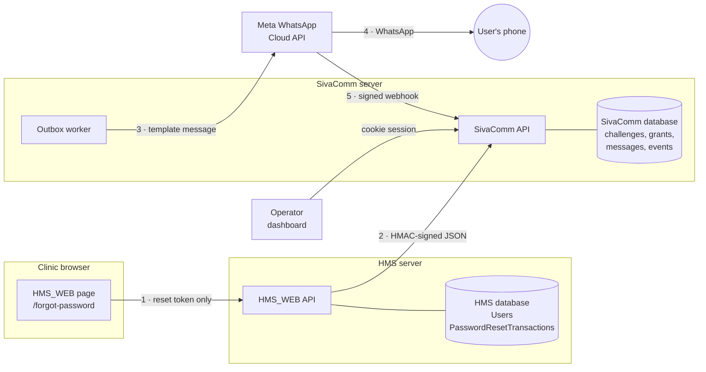
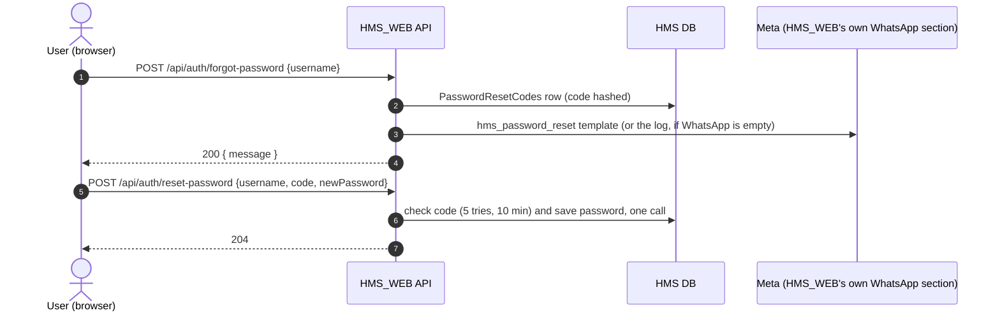
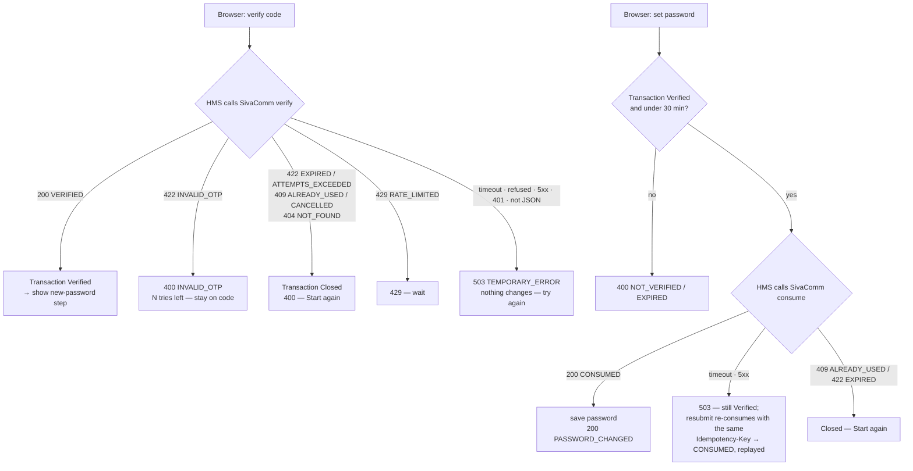
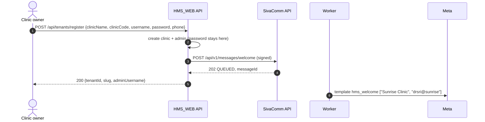
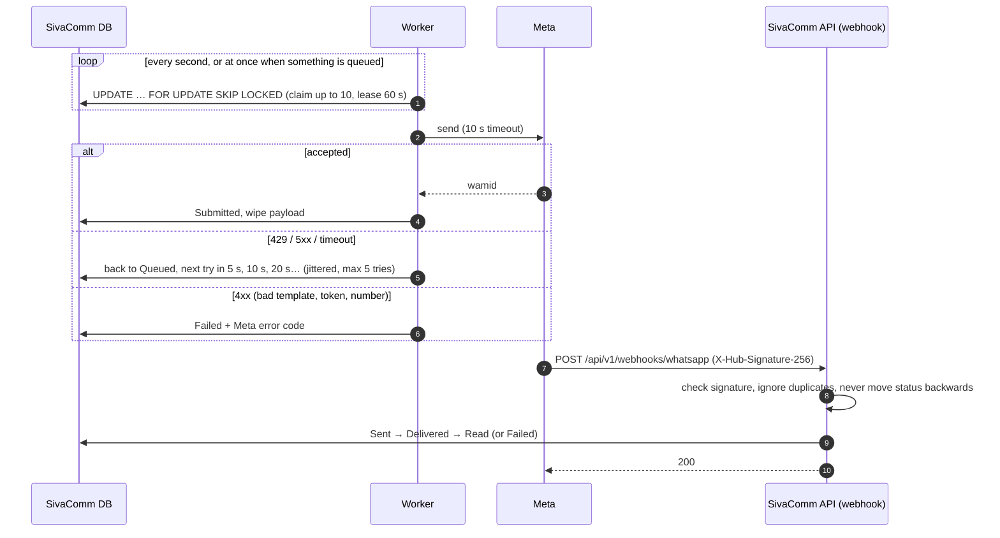
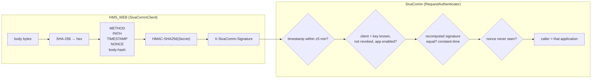
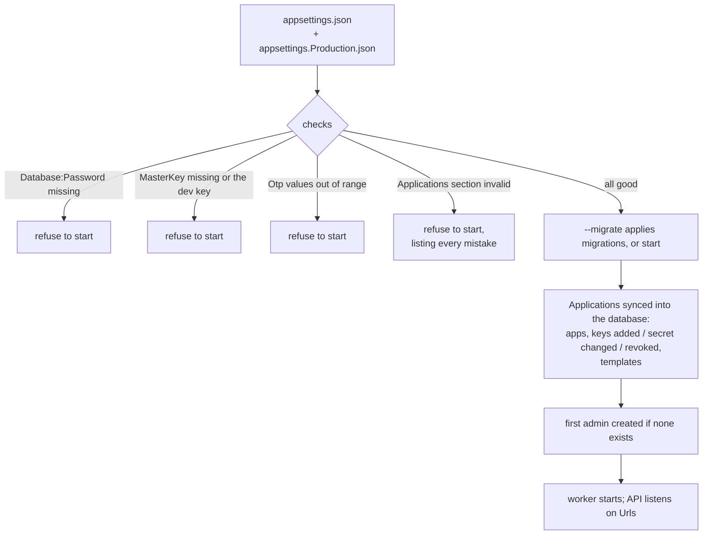
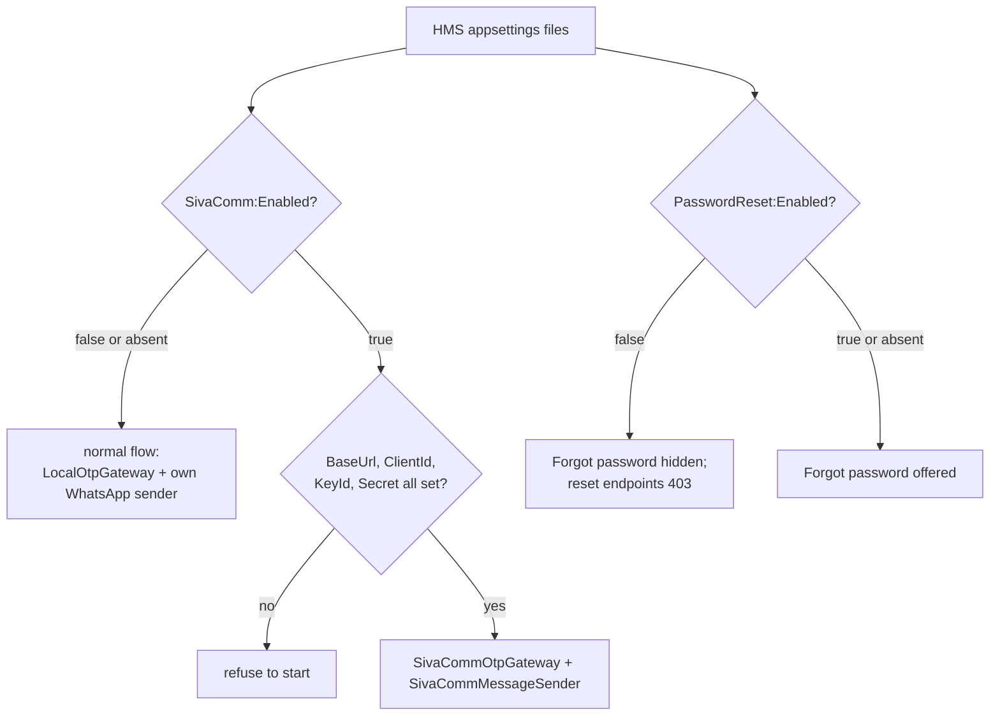

# Workflows: every request and response

What travels between the browser, HMS_WEB, SivaComm and Meta, one hop at a
time, with real bodies. The diagrams are Mermaid: they render on GitHub, in
VS Code (with a Mermaid extension) and in most Markdown viewers.

- [1. The big picture](#1-the-big-picture)
- [2. Password reset with SivaComm (`SivaComm:Enabled = true`)](#2-password-reset-with-sivacomm)
- [3. Password reset, normal flow (`SivaComm:Enabled = false`)](#3-password-reset-normal-flow)
- [4. When it goes wrong](#4-when-it-goes-wrong)
- [5. Welcome message](#5-welcome-message)
- [6. Sending and delivery receipts](#6-sending-and-delivery-receipts)
- [7. How a signed request is built and checked](#7-how-a-signed-request-is-built-and-checked)
- [8. Startup: how the config file becomes live settings](#8-startup-how-the-config-file-becomes-live-settings)

---

## 1. The big picture



| Hop | Authenticated by | Carries |
|---|---|---|
| Browser → HMS_WEB | nothing (anonymous, like sign-in) | username, then an opaque `resetToken`, the code, the new password |
| HMS_WEB → SivaComm | HMAC signature with the key from both config files | reset reference, user reference, phone, code — **never** a password |
| SivaComm → Meta | `WhatsApp:AccessToken` | template name, language, phone, parameters |
| Meta → SivaComm | `X-Hub-Signature-256` with `WhatsApp:AppSecret` | message id + status |
| Operator → SivaComm | dashboard login cookie | reads counts and history; manages applications |

---

## 2. Password reset with SivaComm

`SivaComm:Enabled = true` in HMS_WEB's config file.

```mermaid
sequenceDiagram
    autonumber
    actor U as User (browser)
    participant H as HMS_WEB API
    participant HD as HMS DB
    participant S as SivaComm API
    participant SD as SivaComm DB
    participant W as Worker
    participant M as Meta

    rect rgb(235, 245, 255)
    Note over U,M: Step 1 — ask for a code
    U->>H: POST /api/auth/forgot-password
    H->>HD: find clinic + user + phone on file
    H->>HD: close user's open resets, insert transaction (CodeSent)
    H->>S: POST /api/v1/otp/challenges (signed)
    S->>SD: supersede old challenges, insert challenge (HMAC of code) + outbox row (code encrypted)
    S-->>H: 202 QUEUED, challengeId
    H->>HD: save challengeId
    H-->>U: 200 generic message + resetToken
    W->>SD: claim queued row
    W->>M: send template sivayaan_otp
    M-->>W: 200 wamid
    W->>SD: Submitted, wipe encrypted code
    M--)U: WhatsApp: "482913 is your verification code"
    end

    rect rgb(240, 255, 240)
    Note over U,M: Step 2 — verify the code
    U->>H: POST /api/auth/verify-reset-code
    H->>S: POST /api/v1/otp/challenges/{id}/verify (signed)
    S->>SD: lock row; check app, reference, status, expiry, attempts, HMAC
    S-->>H: 200 VERIFIED + verificationGrant
    H->>HD: transaction → Verified, grant stored encrypted
    H-->>U: 200 VERIFIED (no grant)
    end

    rect rgb(255, 248, 235)
    Note over U,M: Step 3 — set the new password
    U->>H: POST /api/auth/reset-password
    H->>HD: transaction must be Verified, < 30 min old
    H->>S: POST /api/v1/grants/consume + Idempotency-Key (signed)
    S->>SD: lock grant; mark consumed
    S-->>H: 200 CONSUMED + userReference
    H->>HD: one save: password hash, MustChangePassword=false, transaction → PasswordChanged
    H-->>U: 200 PASSWORD_CHANGED
    H->>S: POST /api/v1/otp/challenges/{id}/completion (signed, reporting only)
    S-->>H: 200 COMPLETED
    end
```

### Step 1 — ask for a code

**① Browser → HMS_WEB**

```http
POST /api/auth/forgot-password
Content-Type: application/json

{ "username": "drsri@sunrise" }
```

**② HMS_WEB → SivaComm** (headers explained in [§7](#7-how-a-signed-request-is-built-and-checked))

```http
POST /api/v1/otp/challenges
X-SivaComm-Client: hms-web
X-SivaComm-Key-Id: hms-2026-10
X-SivaComm-Timestamp: 2026-10-25T09:00:00.0000000+00:00
X-SivaComm-Nonce: 5b0e2c1f9a8d4e7b8c6a1d2e3f4a5b6c
X-SivaComm-Signature: q4m1…base64…=
Content-Type: application/json

{
  "resetReference": "hms-0192f1c4a7b34e2c9d5e6f7a8b9c0d1e",
  "userReference":  "u-6f1c2b3a4d5e4f6a8b9c0d1e2f3a4b5c",
  "phone":          "+91 98765 43210",
  "purpose":        "PASSWORD_RESET"
}
```

**③ SivaComm → HMS_WEB**

```http
HTTP/1.1 202 Accepted
X-Correlation-Id: 7c1d…

{
  "success": true,
  "status": "QUEUED",
  "challengeId": "0192f1c4-b8e2-7a31-9c4d-5e6f7a8b9c0d",
  "resetReference": "hms-0192f1c4a7b34e2c9d5e6f7a8b9c0d1e",
  "expiresAtUtc": "2026-10-25T09:10:00Z",
  "resendAvailableAtUtc": "2026-10-25T09:01:00Z",
  "correlationId": "7c1d…"
}
```

The code itself is not in this response. It exists only as an HMAC in the
challenge and, encrypted, in the outbox row until the worker sends it.

**④ HMS_WEB → browser** — identical for every username, real or not:

```json
{
  "message": "If that account exists and has a phone number on file, a code is on its way. It is valid for 10 minutes.",
  "resetToken": "Jm3kQ9…43 characters…"
}
```

**⑤ Worker → Meta** (a moment later)

```http
POST https://graph.facebook.com/v21.0/{PhoneNumberId}/messages
Authorization: Bearer {WhatsApp:AccessToken}

{
  "messaging_product": "whatsapp",
  "recipient_type": "individual",
  "to": "919876543210",
  "type": "template",
  "template": {
    "name": "sivayaan_otp",
    "language": { "code": "en" },
    "components": [
      { "type": "body",   "parameters": [ { "type": "text", "text": "482913" } ] },
      { "type": "button", "sub_type": "url", "index": "0",
        "parameters": [ { "type": "text", "text": "482913" } ] }
    ]
  }
}
```

**⑥ Meta → worker**

```json
{ "messaging_product": "whatsapp", "contacts": [ { "wa_id": "919876543210" } ],
  "messages": [ { "id": "wamid.HBgMOTE5ODc2NTQzMjEwFQIAERgS…" } ] }
```

### Step 2 — verify the code

**① Browser → HMS_WEB**

```json
POST /api/auth/verify-reset-code
{ "resetToken": "Jm3kQ9…", "code": "482913" }
```

**② HMS_WEB → SivaComm** (signed)

```json
POST /api/v1/otp/challenges/0192f1c4-b8e2-7a31-9c4d-5e6f7a8b9c0d/verify
{ "resetReference": "hms-0192f1c4a7b34e2c9d5e6f7a8b9c0d1e", "otp": "482913" }
```

**③ SivaComm → HMS_WEB** — correct code:

```json
HTTP/1.1 200 OK
{
  "success": true,
  "status": "VERIFIED",
  "challengeId": "0192f1c4-b8e2-7a31-9c4d-5e6f7a8b9c0d",
  "resetReference": "hms-0192f1c4a7b34e2c9d5e6f7a8b9c0d1e",
  "verificationGrant": "pV7x…43 characters…",
  "expiresAtUtc": "2026-10-25T09:12:30Z",
  "correlationId": "…"
}
```

Wrong code:

```json
HTTP/1.1 422 Unprocessable Entity
{ "success": false, "status": "INVALID_OTP",
  "message": "The OTP is invalid. Please try again.",
  "challengeId": "0192f1c4-…", "remainingAttempts": 4, "correlationId": "…" }
```

**④ HMS_WEB → browser** — the grant stays on the server, encrypted:

```json
HTTP/1.1 200 OK
{ "status": "VERIFIED", "message": "Code verified. Choose a new password.", "remainingAttempts": null }
```

```json
HTTP/1.1 400 Bad Request
{ "status": "INVALID_OTP", "message": "That code is not right. Check the message and try again.", "remainingAttempts": 4 }
```

### Step 3 — set the new password

**① Browser → HMS_WEB**

```json
POST /api/auth/reset-password
{ "resetToken": "Jm3kQ9…", "newPassword": "Sunrise@2026!" }
```

The password stops here. Nothing below carries it.

**② HMS_WEB → SivaComm** (signed; the reset reference doubles as idempotency key)

```http
POST /api/v1/grants/consume
Idempotency-Key: hms-0192f1c4a7b34e2c9d5e6f7a8b9c0d1e

{ "grant": "pV7x…", "resetReference": "hms-0192f1c4a7b34e2c9d5e6f7a8b9c0d1e" }
```

**③ SivaComm → HMS_WEB**

```json
HTTP/1.1 200 OK
{ "success": true, "status": "CONSUMED",
  "challengeId": "0192f1c4-…",
  "resetReference": "hms-0192f1c4a7b34e2c9d5e6f7a8b9c0d1e",
  "userReference":  "u-6f1c2b3a4d5e4f6a8b9c0d1e2f3a4b5c",
  "replayed": false, "correlationId": "…" }
```

HMS_WEB checks both references match its own transaction, then — in one
database transaction — stores the new password hash, clears
`MustChangePassword` and marks the reset `PasswordChanged`.

**④ HMS_WEB → browser**

```json
HTTP/1.1 200 OK
{ "status": "PASSWORD_CHANGED", "message": "Your password has been changed. Sign in with it now.", "remainingAttempts": null }
```

**⑤ HMS_WEB → SivaComm** (reporting only, after the user already has their answer)

```json
POST /api/v1/otp/challenges/0192f1c4-…/completion
{ "resetReference": "hms-0192f1c4a7b34e2c9d5e6f7a8b9c0d1e", "outcome": "PASSWORD_CHANGED" }
→ 200 { "success": true, "status": "COMPLETED", … }
```

---

## 3. Password reset, normal flow

`SivaComm:Enabled = false` (the default). HMS_WEB exactly as it was before
SivaComm: the original page (code and new password on one screen), the
original two requests, and SivaComm is never called.



```json
POST /api/auth/forgot-password   { "username": "drsri@sunrise" }
→ 200 { "message": "If that account exists and has a phone number on file, a code is on its way. It is valid for 10 minutes." }

POST /api/auth/reset-password    { "username": "drsri@sunrise", "code": "482913", "newPassword": "Sunrise@2026!" }
→ 204 No Content
→ 400 "That code is not right, or it has expired. Ask for a new one."
```

---

## 4. When it goes wrong



Example — SivaComm unreachable at verify:

```json
HTTP/1.1 503 Service Unavailable
{ "status": "TEMPORARY_ERROR",
  "message": "We could not check that right now. Your code may still be valid — try again in a moment.",
  "remainingAttempts": null }
```

Example — a grant replayed with another key:

```json
HTTP/1.1 409 Conflict
{ "success": false, "status": "ALREADY_USED", "message": "This has already been used. Start the reset again.", "correlationId": "…" }
```

Example — self-service reset switched off (`PasswordReset:Enabled = false`):

```json
HTTP/1.1 403 Forbidden
{ "status": "DISABLED", "message": "Self-service password reset is turned off. Ask your clinic admin to reset your password.", "remainingAttempts": null }
```

---

## 5. Welcome message



```json
POST /api/v1/messages/welcome
{
  "clientReference": "welcome-9f2c1e7a0b4d4c6e8a1b3d5f7e9c0a2b",
  "phone": "+91 98765 43210",
  "parameters": [ "Sunrise Clinic", "drsri@sunrise" ]
}
→ 202 { "success": true, "status": "QUEUED", "messageId": "0192f1c6-…", "correlationId": "…" }
```

`clientReference` is derived from the content, so a retried registration
gets the same `messageId` back instead of a second message. The parameter
count must match `Applications[].Templates.Welcome.Parameters` in
SivaComm's config file (here 2), or the request is refused with
`400 INVALID_REQUEST`.

---

## 6. Sending and delivery receipts



What Meta posts:

```http
POST /api/v1/webhooks/whatsapp
X-Hub-Signature-256: sha256=9b1c…

{
  "object": "whatsapp_business_account",
  "entry": [ { "changes": [ { "field": "messages", "value": {
    "statuses": [
      { "id": "wamid.HBgMOTE5ODc2NTQzMjEwFQIAERgS…", "status": "delivered",
        "timestamp": "1761382805", "recipient_id": "919876543210" }
    ] } } ] } ]
}
```

---

## 7. How a signed request is built and checked



```
canonical = "POST" + "\n"
          + "/api/v1/otp/challenges" + "\n"
          + "2026-10-25T09:00:00.0000000+00:00" + "\n"
          + "5b0e2c1f9a8d4e7b8c6a1d2e3f4a5b6c" + "\n"
          + "e3b0c442…(hex SHA-256 of the body)"

X-SivaComm-Signature = base64( HMAC-SHA256( Secret, canonical ) )
```

Any failed check → `401 { "success": false, "status": "UNAUTHORIZED" }`,
one answer for every cause.

**Where the Secret comes from:** the same value is written in two config
files — SivaComm's `Applications[].Keys[].Secret` and HMS_WEB's
`SivaComm:Secret` (with the matching `KeyId`).

---

## 8. Startup: how the config file becomes live settings



HMS_WEB at startup:


